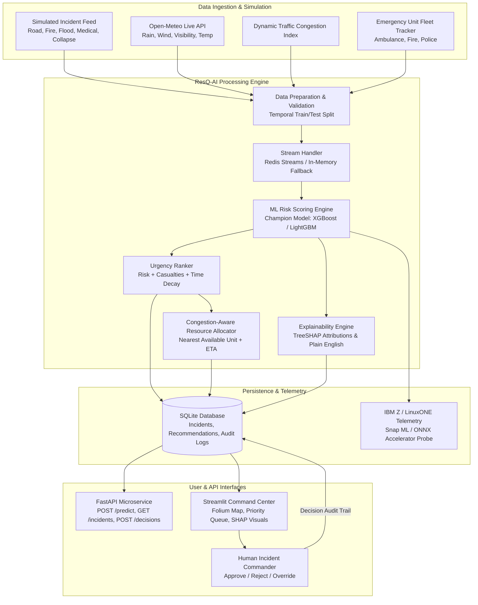

# ResQ-AI: Real-Time AI for Emergency Decision-Support

[](LICENSE)
[](https://www.python.org/)
[](https://fastapi.tiangolo.com)
[](https://streamlit.io)
[](https://www.ibm.com/community/z/)

> **IMPORTANT NOTICE:**  
> **Decision Support Only:** ResQ-AI provides decision support and resource recommendations for incident commanders. The system **never** dispatches units autonomously; every single action requires explicit human verification and approval.  
> **Data Transparency:** All incident labels and telemetry in this demonstration are **simulated/synthetic** for safety and privacy. No proprietary or sensitive personal information is used. Real performance metrics in this repository reflect actual code benchmark runs.

---

## 1. Summary

**ResQ-AI** is an AI-assisted real-time emergency decision-support platform created for the **IBM Z Datathon 2026** challenge (*"Real-Time AI for Critical Decisions"*). In crisis situations—such as flash floods, severe road collisions, or mass-casualty events—emergency control centers face overwhelming streams of incomplete reports. ResQ-AI ingests multi-source incident reports, enriches them with live micro-weather and traffic congestion telemetry, computes risk scores using machine learning, ranks incidents by human urgency, and recommends optimal dispatch routes for nearby emergency response units. A human incident commander retains total authority at every step, reviewing transparent SHAP explainability insights before clicking "Approve" or "Reject".

---

## 2. The Problem

During major emergencies, emergency dispatch rooms experience:
1. **Cognitive Overload:** Hundreds of incoming emergency calls within minutes, making it difficult to identify the most life-threatening incidents.
2. **Static Prioritization:** Traditional CAD (Computer-Aided Dispatch) systems rely on static categorization codes that fail to account for weather severity (e.g. heavy rain washing out roads) or compounding traffic congestion.
3. **Black-Box AI Skepticism:** Field commanders reject recommendations if they cannot see *why* an AI flagged one incident higher than another.
4. **Autonomous Dispatch Hazards:** Fragile or unchecked automation can misallocate scarce medical and rescue resources with fatal consequences.

---

## 3. The ResQ-AI Solution

ResQ-AI solves these challenges by combining machine learning risk scoring, dynamic urgency ranking, explainable AI, and congestion-aware resource matching into a single unified operational dashboard with a strict Human-in-the-Loop workflow:

```
[ Incoming Emergency Telemetry & Weather ]
                   │
                   ▼
       [ Data Cleaning & Validation ]
                   │
                   ▼
     [ Machine Learning Risk Scoring ]
       (LogReg, RF, XGBoost, LightGBM)
                   │
                   ▼
 [ Urgency Ranking & Resource Allocation ]
       (Haversine + Congestion ETA)
                   │
                   ▼
  [ Transparent SHAP Explainability ]
                   │
                   ▼
  [ Human Commander Review & Approval ]
                   │
                   ▼
   [ Immutable Audit Log in SQLite ]
```

---

## 4. Architecture Diagram



---

## 5. Visual Dashboard Walkthrough

The ResQ-AI Streamlit Command Center features 5 dedicated operational tabs:

### Tab 1: Live Command View
- Interactive Folium spatial map of Delhi showing emergency incidents color-coded by AI risk level.
- Unit locations (Ambulances, Fire Engines, Police Cruisers) with real-time status indicators.
- Live scenario switcher (Normal Day, Heavy Rain & Floods, Highway Pileup, City-Wide Surge).
- One-click "Next Tick" time stepper and high-urgency audio-visual alert banner.

### Tab 2: Priority Queue & Dispatch Recommendations
- Live-ranked incident queue combining ML risk score, estimated people affected, and report elapsed time.
- Recommended unit ID, distance, and congestion-adjusted ETA.
- Clear SHAP-derived dispatch reasons in plain English.
- Interactive **Approve** and **Reject** buttons logging decisions with timestamp and commander ID into SQLite.

### Tab 3: AI Explainability (SHAP)
- Per-incident local feature importance breakdown.
- Visual waterfall and bar charts showing positive and negative risk contributors.

### Tab 4: Performance & Benchmarking
- Real empirical evaluation comparing the champion ML model against a rule-based baseline.
- ROC-AUC, PR-AUC, NDCG@k ranking quality, and Top-k recall metrics across test scenarios.

### Tab 5: IBM Z & LinuxONE Telemetry
- Real-time environment interrogation (`platform.machine()`).
- IBM Snap ML acceleration status and ONNX Runtime fallback indicators.
- Live latency distribution (p50, p90, p95, p99 micro-benchmarks).

*(Screenshots will be captured and documented in `docs/screenshots/`)*

---

## 6. Key Features

- **Multi-Model ML Pipeline:** Trains and rigorously compares Logistic Regression, Random Forest, XGBoost, and LightGBM. Automatically selects the champion model based on validation metrics.
- **Congestion-Aware Resource Dispatch:** Calculates Haversine distances and models speed degradation under heavy traffic congestion ($ETA = \frac{\text{Distance}}{\text{Speed} \times (1 - 0.7 \times \text{Congestion})}$).
- **Graceful Fault Tolerance:**
  - Redis Streams $\rightarrow$ automatic thread-safe in-memory FIFO queue fallback.
  - Open-Meteo API $\rightarrow$ realistic sinusoidal/stochastic meteorological generator fallback.
  - IBM Snap ML $\rightarrow$ standard CPU scikit-learn/XGBoost/LightGBM fallback.
- **Explainable Dispatches:** Translates complex tree ensembles into immediate human rationale (e.g., *"Extreme rainfall (42 mm/h) and severe traffic congestion (0.84) elevated incident urgency"*).
- **FastAPI Backend:** Fully asynchronous, OpenAPI/Swagger documented endpoints with Pydantic type safety.
- **Audit-Compliant SQLite Storage:** Every recommendation, approval, rejection, and commander override is permanently stored with timestamps.

---

## 7. Tech Stack

| Component | Technology | Role |
| :--- | :--- | :--- |
| **Language** | Python 3.10+ | Core programming runtime |
| **ML Models** | scikit-learn, XGBoost, LightGBM | Risk prediction & baseline comparison |
| **Explainability** | SHAP (TreeSHAP) | Local feature attribution & human explanations |
| **Data Processing** | pandas, NumPy | Feature engineering & temporal validation |
| **REST API** | FastAPI, Uvicorn, Pydantic | Real-time prediction & dispatch microservice |
| **Streaming** | Redis Streams / In-Memory Queue | Asynchronous event processing |
| **Persistence** | SQLite (SQLAlchemy / sqlite3) | Incident storage & decision audit logging |
| **Dashboard** | Streamlit, Folium, Plotly | Geospatial mapping & command interface |
| **Accelerated Inference**| ONNX, skl2onnx, IBM Snap ML | Enterprise hardware acceleration & export |
| **Testing & Quality** | pytest | Automated unit and integration test suite |
| **Weather Telemetry** | Open-Meteo REST API | Live environmental data (free, no API key) |

---

## 8. How to Run

### Quick Start (One Command)

```bash
# Clone the repository
git clone <repo-url>
cd resq-ai

# Create and activate virtual environment
# On Windows:
py -3 -m venv venv
.\venv\Scripts\activate

# On Linux / macOS:
python3 -m venv venv
source venv/bin/activate

# Install dependencies
pip install -r requirements.txt

# Run complete demo (trains models, runs benchmarks, launches API & Dashboard)
python run_demo.py
```

### Manual Individual Commands

```bash
# 1. Run full test suite
pytest -v

# 2. Train and select the champion ML model
python scripts/train.py

# 3. Run cross-scenario evaluation and generate docs/results.md
python scripts/evaluate.py

# 4. Benchmark inference latency (p50, p95, throughput)
python scripts/benchmark_latency.py

# 5. Export champion model to ONNX format
python scripts/export_onnx.py

# 6. Launch FastAPI backend service (port 8000)
uvicorn src.resq.api:app --host 0.0.0.0 --port 8000

# 7. Launch Streamlit Command Center (port 8501)
streamlit run app/dashboard.py
```

---

## 9. Repository Structure

```text
resq-ai/
├── README.md                          # Main project guide
├── LICENSE                            # MIT License
├── requirements.txt                   # Dependency declarations
├── .gitignore                         # Git exclusion rules
├── run_demo.py                        # One-command orchestration entrypoint
├── plan.md                            # Comprehensive development plan
├── src/resq/                          # Core application package
│   ├── __init__.py
│   ├── config.py                      # Geographic, model, and weight configurations
│   ├── simulator.py                   # Multi-scenario incident & resource simulator
│   ├── data_prep.py                   # Range validation, feature creation, time split
│   ├── weather.py                     # Live Open-Meteo fetcher + synthetic fallback
│   ├── models.py                      # Multi-model training, scoring, & selection
│   ├── ranking.py                     # Urgency ranking + fixed-rule baseline
│   ├── allocation.py                  # Nearest unit allocation & congestion ETA
│   ├── explain.py                     # SHAP explanations & plain text summaries
│   ├── stream.py                      # Redis Streams / In-memory event streaming
│   ├── storage.py                     # SQLite incident & decision persistence
│   ├── api.py                         # FastAPI web service endpoints
│   └── ibmz.py                        # Hardware detection & Snap ML / ONNX probe
├── app/
│   └── dashboard.py                   # 5-Tab Streamlit Command Center
├── scripts/
│   ├── train.py                       # Training pipeline script
│   ├── evaluate.py                    # Evaluation runner & results generator
│   ├── benchmark_latency.py           # Real inference latency profiling
│   └── export_onnx.py                 # Model export script
├── tests/                             # Complete pytest suite
│   ├── test_simulator.py
│   ├── test_data_prep.py
│   ├── test_models.py
│   ├── test_ranking.py
│   ├── test_allocation.py
│   ├── test_storage.py
│   ├── test_stream.py
│   └── test_api.py
├── docs/
│   ├── ARCHITECTURE.md                # System design & Mermaid diagrams
│   ├── DATA.md                        # Dataset documentation & synthetic formulas
│   ├── IBM_Z_PLAN.md                  # LinuxONE (s390x) & IBM Telum accelerator guide
│   ├── results.md                     # Empirical evaluation tables & latencies
│   └── screenshots/                   # Live system interface captures
└── data/
    └── sample_incidents.csv           # Seed sample dataset
```

---

## 10. Evaluation & Empirical Results

ResQ-AI evaluates performance using real execution numbers computed on multiple simulated seeds and scenarios:
- **Discrimination:** ROC-AUC and PR-AUC on held-out test splits.
- **Ranking Quality:** Normalized Discounted Cumulative Gain (NDCG@k) and Spearman rank correlation between urgency ranking and true severity.
- **High-Risk Recall:** Top-k recall quantifying what proportion of critical life-safety incidents appear in the top-k recommendations.
- **Baseline Comparison:** Direct benchmark against a deterministic severity-first baseline.
- **Latency Profiling:** End-to-end inference and recommendation latency (p50, p90, p95, p99).

*All measured metrics are automatically computed and written to [docs/results.md](docs/results.md).*

---

## 11. IBM Z and LinuxONE Integration

IBM Z enterprise servers and LinuxONE (s390x architecture) provide unmatched transaction volume, sub-millisecond AI inference on live transactional data, and mission-critical 99.99999% availability:

- **Colocated Inference:** Running ResQ-AI alongside core city emergency dispatch databases on LinuxONE eliminates external network latency and data exfiltration risks.
- **IBM Telum AI Accelerator:** Through **IBM Snap ML** and ONNX Runtime, models can exploit the on-chip Integrated Accelerator for AI on IBM z16 / LinuxONE III for microsecond-level scoring.
- **Deployment Roadmap:** See [docs/IBM_Z_PLAN.md](docs/IBM_Z_PLAN.md) for step-by-step instructions on deploying the ResQ-AI stack on Red Hat Enterprise Linux / Ubuntu running on s390x.
*(Note: As documented in IBM_Z_PLAN.md, local execution was validated on x86_64/ARM64, and execution on s390x is architecturally planned and detailed with reproducible deployment scripts).*

---

## 12. Responsible AI & Ethics

1. **Human-in-the-Loop Safeguard:** ResQ-AI acts solely as an advisor. All resource allocations require human commander approval before execution.
2. **Transparent Rationale:** Every priority score includes human-readable feature attributions so dispatchers understand the rationale behind risk elevations.
3. **Privacy by Design:** System operates on simulated public incident structures; no PII (Personally Identifiable Information) is captured or retained.
4. **Fairness & Unbiased Allocation:** Allocations are governed by physical Haversine distance, verified transit feasibility, and objective urgency scores—preventing neighborhood or socio-economic dispatch biases.

---

## 13. Limitations & Future Work

### Limitations
- **Synthetic Labels:** Because emergency services understandably protect live operational dispatch logs, training labels in this prototype are generated via documented synthetic equations with Gaussian noise.
- **Road Network Topology:** Current ETAs use Haversine Euclidean distance modulated by a global traffic congestion factor rather than full OpenStreetMap turn-by-turn routing graphs.
- **Resource Specialization:** Units are categorized into Ambulance, Fire, and Police; advanced sub-specializations (e.g., hazmat, high-angle rescue) are left for future releases.

### Future Work
- Integration with real open emergency datasets (e.g., Seattle 911 Calls, UK Police Open Data).
- Turn-by-turn routing via OSRM (Open Source Routing Machine) or Google Routes API.
- Native deployment and benchmark validation on an IBM z16 / LinuxONE Community Cloud instance.
- Multi-agency federation allowing police, fire, and health departments to coordinate cross-jurisdictional incidents.

---

## 14. Open Source Resources & Citations

- **XGBoost:** Chen, T., & Guestrin, C. (2016). *XGBoost: A Scalable Tree Boosting System.* [GitHub](https://github.com/dmlc/xgboost)
- **LightGBM:** Ke, G. et al. (2017). *LightGBM: A Highly Efficient Gradient Boosting Decision Tree.* [GitHub](https://github.com/microsoft/LightGBM)
- **SHAP:** Lundberg, S. M., & Lee, S. I. (2017). *A Unified Approach to Interpreting Model Predictions.* [GitHub](https://github.com/shap/shap)
- **Open-Meteo:** Free Weather API under Creative Commons attribution. [open-meteo.com](https://open-meteo.com)
- **FastAPI:** Modern, high-performance web framework for APIs. [fastapi.tiangolo.com](https://fastapi.tiangolo.com)
- **Folium & Leaflet:** Python wrappers for Leaflet.js interactive mapping. [python-visualization.github.io/folium](https://python-visualization.github.io/folium/)
- **IBM Snap ML:** Accelerated Machine Learning. [ibm.com/analytics/snap-ml](https://www.ibm.com/analytics/snap-ml)

---

## 15. Team & Acknowledgments

**IBM Z Datathon 2026 Submission**  
- **Syed Rizwana** — Team Lead
- **Pagadala Narasimha** — Core ML & Backend Architecture
- **Vanakuri Sai Dhanushya** — Data Engineering & Simulation
- **Sathi Vijaya Sri** — Geospatial Analytics & Explainability
- **Konga Kirani** — Frontend & System Integration

---

## 16. License

This project is licensed under the MIT License - see the [LICENSE](LICENSE) file for details.
