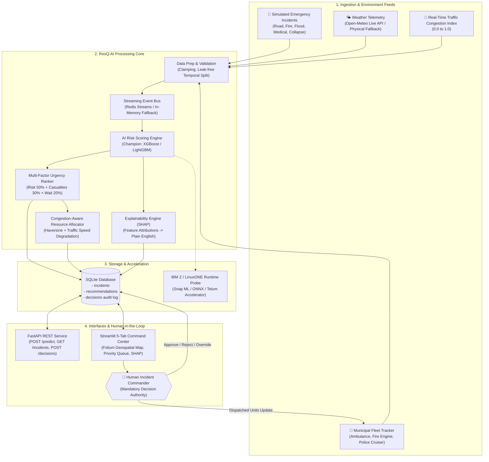

# ResQ-AI System Architecture

## 1. System Overview

**ResQ-AI** is a real-time emergency decision-support system built for the **IBM Z Datathon 2026** challenge (*"Real-Time AI for Critical Decisions"*). It is designed to assist human dispatchers and incident commanders in emergency operations centers (EOCs) during high-stress crises such as severe weather disasters, flash floods, multiple-vehicle collisions, and city-wide mass-casualty surges.

---

## 2. Core Architectural Layers

### 2.1 Ingestion & Physical Simulation
- **Simulator (`simulator.py`):** Advances time in 15-minute discrete ticks. Dynamically models five incident categories, incident severity levels (1 to 5), people affected estimates, and street topologies within the Delhi metropolitan bounding box.
- **Micro-Weather Service (`weather.py`):** Ingests live precipitation, wind, visibility, and temperature from the free Open-Meteo REST API. In disconnected, air-gapped, or rate-limited environments, it falls back seamlessly to a physical meteorological model simulating diurnal temperature and rain spikes.

### 2.2 Feature Engineering & Model Pipeline
- **Data Preparation (`data_prep.py`):** Ensures absolute data safety by validating physical ranges (clamping out-of-boundary GPS coordinates, non-negative rainfall, normalized traffic indexes). Computes interaction features like `rain_x_congestion` and `casualty_severity_ratio`. Implements strict temporal train/test splitting to prevent future data leakage.
- **Model Training & Comparison (`models.py`):** Rigorously benchmarks four ML architectures:
  1. *Logistic Regression* (with standard scaling)
  2. *Random Forest Classifier*
  3. *XGBoost Classifier*
  4. *LightGBM Classifier*  
  Automatically selects the champion model based on validation ROC-AUC and PR-AUC.

### 2.3 Priority Ranking & Resource Allocation
- **Urgency Scoring (`ranking.py`):** Rather than sorting by static codes, ResQ-AI calculates a holistic Urgency Score ($U \in [0.0, 1.0]$):
  $$U = 0.50 \times \text{Risk}_{\text{AI}} + 0.30 \times \text{Casualties}_{\text{norm}} + 0.20 \times \text{WaitTime}_{\text{norm}}$$
- **Congestion-Aware Dispatch (`allocation.py`):** Assigns the closest suitable available unit using Haversine distance, adjusting arrival estimates for traffic gridlock:
  $$\text{Speed}_{\text{eff}} = \max\left(10, \text{Speed}_{\text{base}} \times (1.0 - 0.70 \times \text{Congestion})\right)$$
  $$\text{ETA} = \left(\frac{\text{Distance}}{\text{Speed}_{\text{eff}}}\right) \times 60 \text{ minutes}$$

### 2.4 Explainability (XAI)
- **SHAP Integration (`explain.py`):** Computes exact local Shapley feature values per incident, translating complex mathematical log-odds impacts into straightforward English explanations (e.g., *"Heavy precipitation (42 mm/h) and road gridlock (0.84) elevated urgency"*).

### 2.5 Persistence & Audit Trail
- **SQLite Database (`storage.py`):** Stores all incoming reports, generated recommendations, and every human commander action.
- **Event Streaming (`stream.py`):** Event-driven stream publishing using Redis Streams with automatic fallback to an in-memory thread-safe queue.

### 2.6 Human-in-the-Loop Interface
- **FastAPI (`api.py`):** Low-latency REST endpoints for programmatic Computer-Aided Dispatch (CAD) integration.
- **Streamlit Command Center (`dashboard.py`):** 5-tab real-time operations dashboard featuring interactive Folium maps, ranked priority queues with **Approve** and **Reject** buttons, SHAP visual charts, empirical evaluation reports, and IBM Z telemetry.
